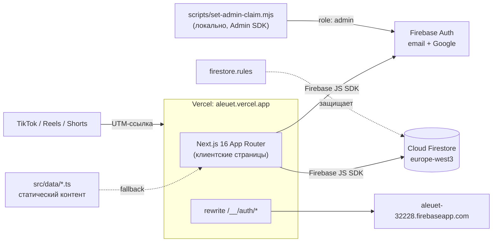
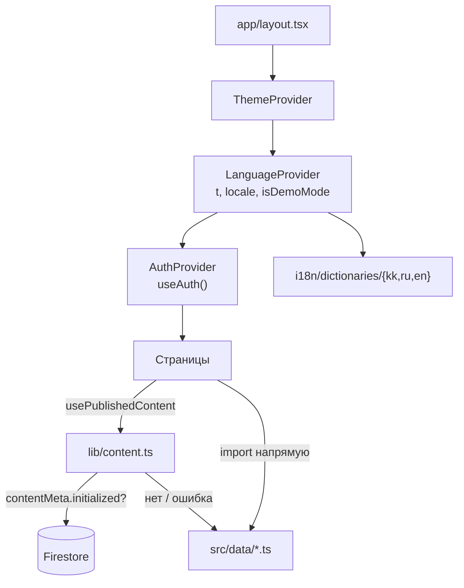
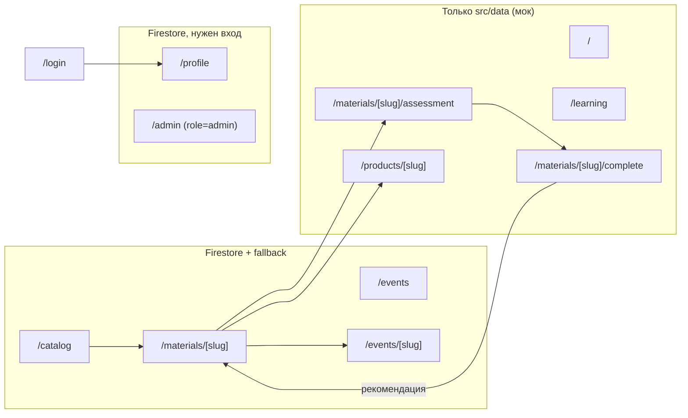
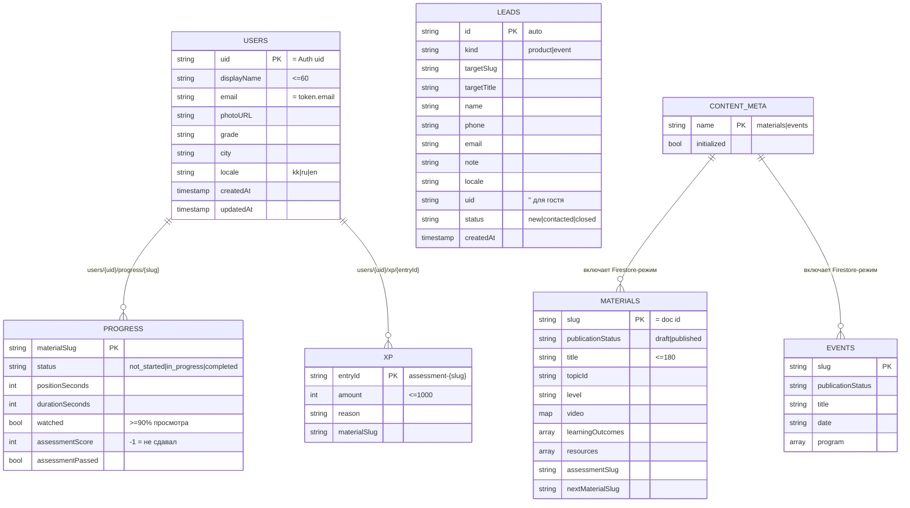
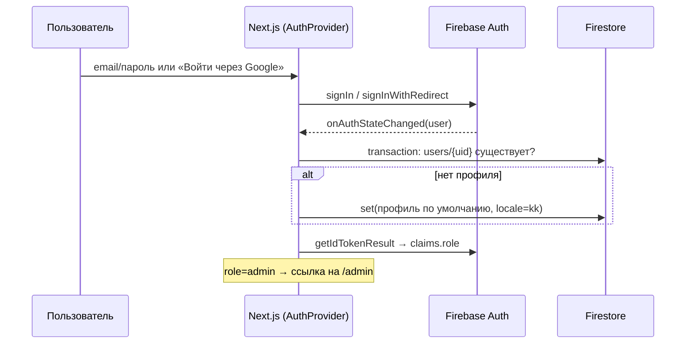
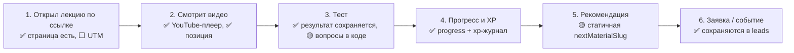

# Архитектура Aleuet

Схемы в формате Mermaid: GitHub и VS Code рисуют их как картинки. Обновляй при изменении архитектуры.

## 1. Система целиком

## 2. Провайдеры и слой данных

## 3. Страницы и источники данных

## 4. Модель данных Firestore

Права (`firestore.rules`):

| Коллекция | Чтение | Запись |
|---|---|---|
| `users/{uid}` | владелец или admin (list только admin) | только владелец, строгая схема полей, без ролей |
| `materials`, `events` | все, если `published`; admin видит всё | только admin |
| `contentMeta/{materials,events}` | все (get) | только admin |
| `users/{uid}/progress` | владелец или admin | владелец, строгая схема |
| `users/{uid}/xp` | владелец или admin | только create владельцем, id = `assessment-{slug}`; изменять и удалять нельзя |
| `leads` | только admin | create — все (строгая схема, status=new); update только `status` — admin |
| остальное | запрещено | запрещено |

## 5. Вход и создание профиля

## 6. Целевой цикл MVP (ТЗ, раздел 18) и текущее состояние

Легенда: ✅ готово · 🟡 частично · ⬜ не сделано. Актуальный статус — в [ROADMAP.md](../ROADMAP.md).
